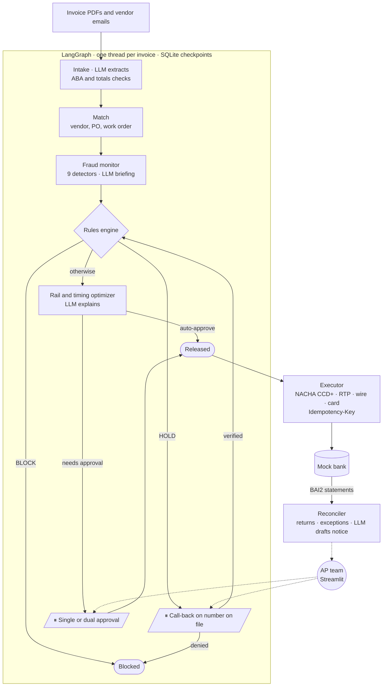

# PropPay Agent

**An agentic accounts-payable desk for real estate, where AI agents run the payment run and
deterministic controls decide whether money moves.**

A property manager's Monday AP run (25 vendor invoices across 12 properties) goes from PDF and email
intake through 3-way match, fraud monitoring, approvals, rail selection, NACHA file generation and bank
reconciliation. LLM agents read, triage and explain. Policy written as code approves, routes and releases.
Everything runs locally on a laptop: no money moves, the bank is mocked, and no data leaves the machine.

> **Demo video:** _add Loom link_ · **Demo script:** [docs/DEMO.md](docs/DEMO.md) (about 4 minutes) · **Spec:** [docs/SPEC.md](docs/SPEC.md)

---

## The idea: agentic payments with bounded authority

Agents are good at the messy parts of payables: reading inconsistent invoices, spotting that an email
"sounds wrong", explaining a risk to a reviewer, drafting a vendor notice. They should never be the thing
that decides to send $480,000. PropPay draws that line explicitly:

| | LLM agents may | LLM agents may not |
|---|---|---|
| **Intake** | extract fields from PDFs and emails; quote pressure language | invent or "fix" values (a quote is discarded unless it appears verbatim in the document) |
| **Fraud** | write a plain-English briefing for the reviewer | change a signal, the risk score or the decision |
| **Rails** | explain why a rail and date were chosen | choose the rail |
| **Reconciliation** | draft the vendor notice for a returned payment | send it, or decide whether a line matches |
| **Money** | none | approve, route, release or retry a payment |

Everything in the right-hand column is pure Python in [`app/rules/`](app/rules), driven by YAML in
[`config/`](config), and unit-tested. Every LLM output is parsed into a Pydantic schema; if parsing fails
twice, the invoice goes to a human rather than being guessed at.

What makes it **agentic** rather than a script:

- **Each invoice is a stateful agent workflow** (LangGraph). It **pauses** for a human when policy requires
  one (a call-back, single or dual approval) and **resumes** hours later, even after a restart, from a
  SQLite checkpoint.
- **Agents hand work to humans with evidence, not just a flag**: the rule that fired, each signal with
  proof, an analyst briefing and the rail rationale, all in one card.
- **Humans hand work back to agents.** A verified call-back switches the vendor's bank account and re-runs
  the rules engine. An approval releases the payment to the executor.
- **Loops are capped** (`MAX_AGENT_STEPS=5`): repeated bad answers escalate instead of looping.

---

## Use cases it demonstrates

Monday's run is seeded with nine real-world situations, each with its expected outcome tested:

| # | Situation | What the agents and rules do | Payments concept |
|---|---|---|---|
| 1 | 18 routine invoices from trusted vendors, under $5k | Extract → full 3-way match → risk 0 → **auto-approve** → one NACHA CCD+ file, sent as late as possible | Straight-through processing, cash timing |
| 2 | Email from **acmeplum*bimg*.com**: "we've changed banks, pay today, reply by email only" | Bank details ≠ account on file, change requested by email, look-alike domain, pressure language → risk 100 → **hold for call-back**. The vendor, called on the number on file, denies the change → **blocked** | Business email compromise / vendor impersonation; Nacha 2026 fraud monitoring |
| 3 | Landscaping invoice resubmitted as `INV-1043-A` | Matches paid `INV-1043`, PO already closed → **single approval** with a duplicate flag (some accounting systems legitimately reuse numbers) | Duplicate payment prevention |
| 4 | Emergency HVAC repair, $3,800, due today | Urgent and low risk → **RTP**, settled today ($0.50 beats same-day ACH at $1.00) | Instant rails are irrevocable, so they're gated on risk |
| 5 | $480,000 construction draw (AIA-style pay application with retainage) | Over $50k and wire-only vendor → **dual approval**; the same person can't approve twice | Dual control, wire economics |
| 6 | Two card-accepting vendors | **Virtual card**, 1% rebate recorded | Card rebates as negative cost |
| 7 | Vendor's account doesn't exist | ACH returns **R03** two days after settlement → payment returned, **invoice reopened**, vendor **flagged** (no auto-pay), LLM drafts a notice | Returns and R-codes, exceptions queue |
| 8 | `2/10 Net 30` terms | 2% for paying 20 days early ≈ 37%/yr vs 8% cost of capital → **pay early**, settle inside the window | Early-pay discount economics |
| 9 | New supplier whose name matches a sanctions entry | **OFAC hard block**, regardless of anything else | Sanctions screening |

---

## Architecture



The run is a fan-out/join: each received invoice goes through its own thread, then a single execution step
batches everything released (one NACHA file with one batch per effective date). Each later approval releases
more payments and triggers another execution pass, which gets a new NACHA file ID modifier (A, B, C…).

### Agents

| Agent | File | LLM does | Deterministic code does |
|---|---|---|---|
| Intake | [`agents/intake.py`](app/agents/intake.py) | Extract 11 fields + line items from PDF/email; quote pressure language | ABA checksum, line items = total, required fields, confidence floor, quote-is-really-in-the-document check |
| Match | [`agents/matcher.py`](app/agents/matcher.py) | (embeddings only when fuzzy matching is inconclusive) | Vendor resolution; 3-way match invoice ↔ PO (±2%) ↔ completed work order |
| Fraud monitor | [`agents/fraud.py`](app/agents/fraud.py) | Reviewer briefing | 9 signal detectors with evidence, weighted risk score |
| Rules engine | [`rules/policy.py`](app/rules/policy.py) | – | BLOCK › HOLD_CALLBACK › DUAL › AUTO › SINGLE; the chosen rail can only make it stricter |
| Rail optimizer | [`agents/rail_optimizer.py`](app/agents/rail_optimizer.py) | Plain-English rationale | Eligibility, cutoffs, business days, discount vs cost of capital, cheapest on-time rail |
| Executor | [`agents/executor.py`](app/agents/executor.py) | – | `release_allowed()` gate, NACHA file, positive pay, idempotent API calls |
| Reconciler | [`agents/reconciler.py`](app/agents/reconciler.py) | Vendor notice for returns | BAI2 parse with control totals, matching, returns, exceptions, vendor trust |

### Fraud signals ([`rules/fraud_signals.py`](app/rules/fraud_signals.py), weights in [`config/fraud.yaml`](config/fraud.yaml))

`BANK_DETAILS_CHANGED` · `BANK_CHANGE_VIA_EMAIL` · `LOOKALIKE_VENDOR` (name or email domain) ·
`DUPLICATE_INVOICE` (`INV-1043-A` ≈ `INV-1043`, or same amount within 30 days) · `AMOUNT_ANOMALY` (> 3σ) ·
`FIRST_TIME_PAYEE` · `NEW_ACCOUNT_RECENT` · `URGENCY_LANGUAGE` · `OFAC_HIT`.
Any bank-detail change forces a call-back before payment, whatever the score.

---

## Controls that are first-class, not bolted on

- **Policy as code:** approval thresholds, auto-pay rules, hard blocks and holds live in
  [`config/policy.yaml`](config/policy.yaml); every decision carries the rule that produced it.
- **Dual control:** two *distinct* approvers for ≥ $50k, any wire, and instant payments ≥ $25k.
- **Idempotency:** every bank call carries `Idempotency-Key = {payment_id}-{attempt}`. A timeout after the
  bank processed the payment is retried with the same key and **pays once** (tested). The same key with a
  different body is a 409.
- **Audit trail:** every state change, by an agent or a person, writes actor, action, before/after JSON and
  the reason.
- **Tokenized bank accounts:** agents and rules see only a hash and the last 4 digits; full numbers live in a
  vault table read only when building bank files.
- **Statements are verified before they're trusted:** a BAI2 file that fails its control totals is reported,
  not reconciled.
- **Local only:** Ollama on localhost; Streamlit telemetry off and bound to localhost.

---

## Results

All numbers come from `qwen3:8b` running locally on a MacBook Pro (18 GB), on the 25 seeded invoices.

| Measure | Result | How |
|---|---|---|
| Extraction field accuracy | **99.6%** (24 of 25 documents fully correct; 10 of 11 fields at 100%) | [`evals/run_extraction_eval.py`](evals/run_extraction_eval.py): 11 fields × 25 docs, precision/recall per field |
| End-to-end decision accuracy | **100%** (25 / 25) | [`evals/run_decision_eval.py`](evals/run_decision_eval.py): live intake → match → fraud → rules vs expected outcome |
| Fraud-signal accuracy | **96%** | same run; see limitations |
| Straight-through processing | **84%** of invoices auto-approved (21 / 25) | same run |
| Demo run (after approvals and reconciliation) | 80% STP · $2,840 fraud stopped · 1 sanctions block · fees $30 vs $550 all-wire · $54.38 discount captured · 22 settled, 1 R03 handled | Streamlit dashboard |
| Tests | **206 passing**: NACHA records, ABA, every policy decision per demo case, rails, duplicates, idempotency, graph pause/resume across restart, reconciliation | `uv run pytest` |

Median extraction time is about 14 s per invoice; the full live run of 25 invoices takes about 7 minutes,
which is why the demo pre-runs an "overnight batch" and processes three invoices live.

**Honest caveats.** The gold set is generated from the same four invoice templates as the demo, so
extraction accuracy is a regression check, not a real-world estimate. The one field below 100% is the
bank account's last four digits on the fraud email (the model reads `451` for `9451`); the ABA and
last-4 validators flag it, and the invoice is held for a call-back anyway. The 8B model also over-flags
"2% discount if paid within 10 days" as payment pressure. That costs 10 risk points and can only send an
invoice to a human, never release one.

---

## Quick start

```bash
# prerequisites: uv, and Ollama (https://ollama.com/download)
ollama pull qwen3:8b && ollama pull nomic-embed-text
uv sync
uv run pytest                                          # 206 tests, ~45 s

uv run uvicorn mock_bank.main:app --port 8001          # terminal 1
uv run python scripts/prepare_demo.py                  # terminal 2: seed + overnight batch (~7 min)
uv run streamlit run ui/Home.py                        # then follow docs/DEMO.md
```

Prefer the terminal? `scripts/run_ap.py run | pending | approve | reject | callback | reconcile` drives the same
graph. `prepare_demo.py --restore` resets to the demo starting point in about 1 second.

## Repo map

```
app/
  agents/      intake, matcher, fraud, decision, rail_optimizer, executor, reconciler
  rules/       policy.py · fraud_signals.py · rails.py · names.py   ← every money decision
  payments/    nacha.py (CCD+ builder/validator) · bai2.py · positive_pay.py · routing.py (ABA) · rcodes.py · vault.py
  prompts/     plain-text prompt templates
  graph.py     LangGraph wiring, interrupts, run orchestration
  llm.py       Ollama client + structured output with one retry, then human review
config/        rails.yaml · policy.yaml · fraud.yaml
mock_bank/     FastAPI: ACH files, RTP/FedNow, wire, card, positive pay, BAI2 statements, R-code returns
ui/            Streamlit: dashboard, payment run, approvals, vendors, audit trail, reconciliation
scripts/       seed_data.py · make_invoice_pdfs.py · prepare_demo.py · run_ap.py
evals/         gold set + extraction and decision evals
tests/         206 tests
```

Stack: Python 3.12 · uv · LangGraph · Ollama (`qwen3:8b`, `nomic-embed-text`) · SQLModel/SQLite · FastAPI ·
Streamlit · reportlab/pdfplumber.

## Payments glossary

**STP**: straight-through processing, paid with no human touch. **3-way match**: invoice vs purchase order vs
completed work. **CCD+**: NACHA corporate credit with a remittance addenda (here an X12 `RMR` segment).
**Same-day ACH / RTP / FedNow**: faster rails; RTP and FedNow are instant and irrevocable. **Positive pay**:
the bank only clears checks you've listed. **R-codes**: ACH return reasons (R03 = no account). **BAI2**:
standard bank statement format. **BEC**: business email compromise. **OFAC SDN**: US sanctions list.

## What this POC deliberately is not

Mock bank only; no real processor or sanctions list (a fictional SDN sample is included). Single tenant, no
authentication. Business days skip weekends but not Fed holidays. Vendor onboarding is covered by OFAC
screening at payment time, mock TIN-match and account-validation endpoints, and the "trusted after 3 clean
payments" rule; the full onboarding workflow from the spec is not built.

## Talking points

- *LLMs triage and explain; deterministic rules move money.*
- Aligned with **Nacha's 2026 risk-based fraud-monitoring rules** for ACH credit originators, focused on
  payments made under false pretenses (vendor impersonation / BEC).
- **Rail economics:** instant payments are irrevocable, so fraud checks gate them; the cheapest on-time rail
  saved $520 on this run vs all-wire.
- **Idempotency, audit trail and dual control** are first-class features.
- **Measured, not vibes:** field-level extraction evals and end-to-end decision accuracy.
- **Zero cost and fully local:** no payments data leaves the machine.
